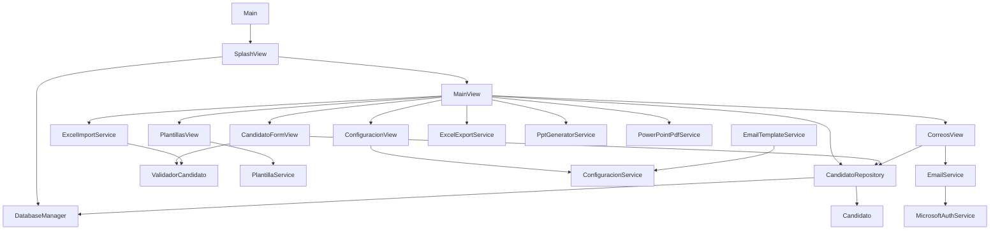

# Arquitectura de CartaOferta Express

Este documento explica qué hace cada archivo y cada clase, y cómo se conectan. Está escrito a partir del código fuente real del proyecto.

## Vista general

La aplicación es de escritorio (JavaFX) y está organizada en capas. Cada capa solo debería hablar con la de abajo:

```
ui  ->  service  ->  repository  ->  database
 \________\______________\________>  model (Candidato lo usan todas)
```

En la práctica, algunas pantallas (`MainView`, `CorreosView`) también llaman directamente a `CandidatoRepository`, sin pasar por un servicio.



> El diagrama refleja las relaciones principales. Algunas dependencias menores no se dibujaron.

## Estructura de carpetas

```
CartaOfertaExpress/
├── pom.xml                      Dependencias y configuración de Maven
├── generar-portable.bat         Crea el ejecutable portable con jpackage
├── icono.ico                    Icono del ejecutable
├── src/main/java/com/cartaofertaexpress/
│   ├── Main.java                Punto de entrada
│   ├── ui/                      Pantallas
│   ├── service/                 Lógica e integraciones
│   ├── repository/              Acceso a datos
│   ├── database/                Conexión SQLite
│   └── model/                   Entidad Candidato
└── src/main/resources/images/   logo.png, inicio.jpeg, encabezado.jpeg
```

Carpetas que **no** están en el repositorio y se usan al ejecutar: `native/` (DLL de Jacob), `datos/`, `plantillas/`, `plantilla_html/`, `cartas_generadas/`.

---

## Punto de entrada

### `Main`
Extiende `javafx.application.Application`. Su método `start` crea un `SplashView` y le pide que se muestre. No hace nada más.

---

## Paquete `database`

### `DatabaseManager`
Gestiona SQLite. Todos sus métodos son estáticos.

- `initializeDatabase()`: crea la carpeta `datos/`, crea la tabla `candidatos` si no existe y aplica las migraciones.
- `getConnection()`: entrega una conexión JDBC a `datos/carta_oferta.db`. Es el único lugar donde se define esa ruta.
- `actualizarEstructura()` y `agregarColumnaSiNoExiste(...)`: migración manual. Agregan con `ALTER TABLE` las columnas que se sumaron en versiones posteriores (`carta_generada`, `archivo_carta`, `fecha_carta`, `plantilla_carta`, `fecha_correo`, `resaltado`).

**Tabla `candidatos`:** `id`, `nombre`, `cedula` (única), `cargo`, `salario`, `rol`, `tipo_contrato`, `fecha_ingreso`, `ciudad`, `tasa`, `celular`, `correo`, `activo`, `resaltado`, `fecha_creacion`, `fecha_modificacion`, más las columnas de migración de arriba.

**Se conecta con:** `SplashView` (la inicializa) y `CandidatoRepository` (pide conexiones).

---

## Paquete `model`

### `Candidato`
Clase de datos (atributos, constructores, getters y setters, `toString`). Un objeto `Candidato` es una fila de la tabla `candidatos`.

Atributos: `id`, `nombre`, `cedula`, `cargo`, `salario` (`BigDecimal`), `rol`, `tipoContrato`, `fechaIngreso` (texto), `ciudad`, `tasa`, `celular`, `correo`, `fechaCorreo`, `activo`, `resaltado`, `cartaGenerada`, `archivoCarta`, `fechaCarta`, `plantillaCarta`.

**Se conecta con:** todas las demás capas la usan para pasarse datos.

---

## Paquete `repository`

### `CandidatoRepository`
Todas las consultas SQL de la aplicación sobre candidatos.

| Método | Qué hace |
|---|---|
| `guardar(candidato)` | Inserta un candidato nuevo |
| `buscarTodos()` | Lista todos |
| `buscarPorId(id)` / `buscarPorCedula(cedula)` | Búsquedas puntuales |
| `actualizar(candidato)` | Modifica un candidato existente |
| `cambiarResaltado(...)` | Marca o desmarca el resaltado |
| `registrarCartaGenerada(...)` | Guarda que la carta se generó (archivo, fecha, plantilla) |
| `eliminarRegistroCarta(...)` | Borra la información de la carta de un candidato |
| `cambiarEstadoCorreo(...)` / `registrarCorreoEnviado(...)` | Estado y fecha del envío de correo |
| `eliminar(id)` | Elimina el candidato |
| `mapearCandidato(...)` (privado) | Convierte una fila SQL en un `Candidato` |

**Se conecta con:** `DatabaseManager`, `Candidato`. Lo usan `MainView`, `CandidatoFormView` y `CorreosView`.

---

## Paquete `service`

### `ValidadorCandidato`
Métodos estáticos de validación y limpieza de datos.

- `validarCedula`: solo números, guiones y puntos.
- `validarCelular`: solo números.
- `validarCorreo`: formato de correo; lo pasa a minúsculas.
- `validarFecha`: formato estricto `dd/MM/aaaa`.
- `normalizarNombre`, `normalizarTexto`, `normalizarSalario`, `normalizarCelular`: limpieza de formato.

Los métodos `validar...` lanzan `IllegalArgumentException` con un mensaje listo para mostrar al usuario.

### `ConfiguracionService`
Lee y escribe `datos/configuracion.properties`. Maneja: plantilla de PowerPoint seleccionada, tipos de contrato (valores por defecto: Término indefinido, Término fijo, Obra o labor, Prestación de servicios, Aprendizaje), tamaño de fuente, tamaño de fuente de la tabla, filas alternadas y la ruta de la plantilla HTML del correo.

También tiene métodos para servidor de correo, puerto, correo remitente y nombre remitente, pero **ninguna otra clase los usa actualmente** (ver "Puntos de atención").

### `PlantillaService`
Administra la carpeta `plantillas/`: `listarPlantillas()`, `agregarPlantilla(...)` (copia un `.pptx` a la carpeta), `eliminarPlantilla(...)` y `getCarpetaPlantillas()`.

### `PptGeneratorService`
Genera el PowerPoint de cada carta usando Apache POI.

- `generarCarta(plantilla, candidato)`: crea `cartas_generadas/<dd-MM-yyyy>/Carta_Oferta_<Nombre>.pptx`.
- `generar(plantilla, candidato, archivoSalida)`: copia la plantilla y reemplaza las variables.
- `construirVariables(candidato)`: define el mapa de variables `{{NOMBRE}}`, `{{CEDULA}}`, `{{CARGO}}`, `{{SALARIO}}`, `{{ROL}}`, `{{TIPO_CONTRATO}}`, `{{FECHA_INGRESO}}`, `{{CIUDAD}}`, `{{TASA}}`, `{{CELULAR}}`, `{{CORREO}}`.
- `reemplazarEnDiapositiva`, `reemplazarEnShape`, `reemplazarEnTexto`: recorren las diapositivas y sustituyen el texto.
- `formatearSalario`: formato con puntos de miles (por ejemplo `3.500.000`).
- `limpiarNombreArchivo`, `obtenerArchivoDisponible`: nombres de archivo seguros y sin repetir.

### `PowerPointPdfService`
`convertir(archivoPptx, archivoPdf)`: abre PowerPoint mediante Jacob (`PowerPoint.Application`), abre el `.pptx`, lo guarda como PDF (formato 32) y cierra PowerPoint. Requiere Windows con PowerPoint y la DLL de Jacob.

### `ExcelImportService`
`importar(archivo)`: lee la primera hoja de un `.xlsx` y devuelve un `ResultadoImportacion` con la lista de candidatos y la cantidad de filas descartadas por no tener cédula. Normaliza encabezados (sin tildes, espacios ni guiones) y acepta variantes: `nombre`, `cedula`, `cargo`, `salario`, `rol`, `tipo contrato`, `fecha ingreso`, `ciudad`, `tasa`, `celular`/`teléfono`, `correo`/`email`. También normaliza fechas, salarios, celulares y correos.

### `ExcelExportService`
`exportar(...)`: genera un archivo Excel con los candidatos.

### `EmailService`
- `enviarCorreo(usuario, destinatario, asunto, html, adjunto)`: obtiene un token con `MicrosoftAuthService` y envía el correo por SMTP (`smtp-mail.outlook.com`, puerto 587, STARTTLS, mecanismo XOAUTH2). El cuerpo es HTML y el adjunto es el PDF.
- `obtenerArchivoPdf(rutaGuardada)`: dada la ruta registrada del candidato, devuelve el `.pdf` (si la base de datos guardó el `.pptx`, busca el PDF equivalente).

### `MicrosoftAuthService`
`obtenerAccessToken()`: abre el inicio de sesión interactivo de Microsoft con MSAL4J (aplicación pública, autoridad `consumers`, permiso `https://outlook.office.com/SMTP.Send`) y devuelve el token de acceso. No usa `clientSecret`.

### `EmailTemplateService`
`obtenerPlantillaHtml()`: lee el archivo HTML cuya ruta guarda `ConfiguracionService`. Lanza error si no hay plantilla configurada.

---

## Paquete `ui`

Todas las pantallas se construyen por código (no hay FXML ni CSS externo).

### `SplashView`
Pantalla de bienvenida con animación. En un hilo aparte inicializa la base de datos (`DatabaseManager.initializeDatabase()`), crea `MainView` y la inicializa, garantizando un tiempo mínimo de visualización. Al terminar abre la ventana principal.

### `MainView`
Pantalla principal y la clase más grande. Contiene la tabla de candidatos y casi todas las acciones.

| Método | Qué hace |
|---|---|
| `inicializarInterfaz()` / `mostrar(stage)` | Construye y muestra la ventana |
| `configurarTabla()` | Columnas, colores de fila y menú de copiar |
| `cargarCandidatos()` / `buscarCandidatos()` | Carga y filtra la tabla |
| `editarCandidato()` / `eliminarCandidato()` | Abren el formulario / eliminan |
| `cambiarResaltadoSeleccionados()` | Resalta filas |
| `importarExcel()` / `exportarExcel()` | Usan los servicios de Excel |
| `generarCartas()` | Genera PPTX y PDF por cada candidato seleccionado en una tarea en segundo plano, con progreso y cancelación |
| `abrirCarta()` / `eliminarCarta()` / `abrirCarpeta()` | Gestión de las cartas generadas |
| `aplicarConfiguracion()` | Aplica tamaños de fuente y filas alternadas |

Abre `CandidatoFormView`, `PlantillasView`, `CorreosView` y `ConfiguracionView`.

### `CandidatoFormView`
Formulario de "Nuevo candidato" / "Editar candidato". Campos: nombre, cédula, tipo de contrato, rol, cargo, fecha de ingreso, salario, ciudad, celular y correo. `guardarCandidato()` valida con `ValidadorCandidato` y guarda con `CandidatoRepository`.

### `PlantillasView`
Ventana para agregar, eliminar y seleccionar la plantilla de PowerPoint activa. Usa `PlantillaService`. `getPlantillaSeleccionada()` devuelve la elegida.

### `CorreosView`
Ventana de envío de correos.

- `validarParaEnvio(...)`: un candidato es apto si ya tiene carta generada y un correo.
- Muestra la lista de no aptos y permite continuar solo con los aptos.
- `cargarPlantillaHtml(...)` y `cargarVistaPrevia(...)`: cargan el HTML del correo y lo previsualizan.
- `reemplazarVariables(...)`: reemplaza `{{nombre}}` por el nombre del candidato.
- `enviarCorreos(...)`: envía con `EmailService` el PDF adjunto con asunto `CARTA OFERTA a <nombre>` y registra el envío con `CandidatoRepository.registrarCorreoEnviado`.

### `ConfiguracionView`
Ventana de configuración con tres secciones: **Apariencia** (tamaño de fuentes, filas alternadas), **Contratos** (agregar, editar y eliminar tipos de contrato) y **Acerca de...**. Guarda con `ConfiguracionService`.

---

## Puntos de atención

Cosas que encontré en el código y conviene saber antes de modificar:

1. **Correo remitente fijo.** `CorreosView.obtenerUsuarioCorreo()` devuelve una dirección escrita directamente en el código, en lugar de leerla de la configuración. Si cambia la cuenta que envía, hay que cambiarla ahí.
2. **Servidor SMTP fijo.** `EmailService` define servidor y puerto como constantes; los métodos de `ConfiguracionService` para servidor, puerto y remitente no se usan.
3. **Rutas relativas.** `datos/`, `plantillas/`, `plantilla_html/` y `cartas_generadas/` dependen de la carpeta desde donde se ejecute la aplicación. Si se lanza desde otro lugar, creará esas carpetas allí y "perderá" los datos anteriores.
4. **Archivos grandes de UI.** `MainView` supera las 4.000 líneas; es el archivo más difícil de modificar con seguridad.
5. **Identificador de la aplicación de Microsoft** (`CLIENT_ID`) escrito en `MicrosoftAuthService`. No es un secreto (es una aplicación pública), pero está fijo en el código.
